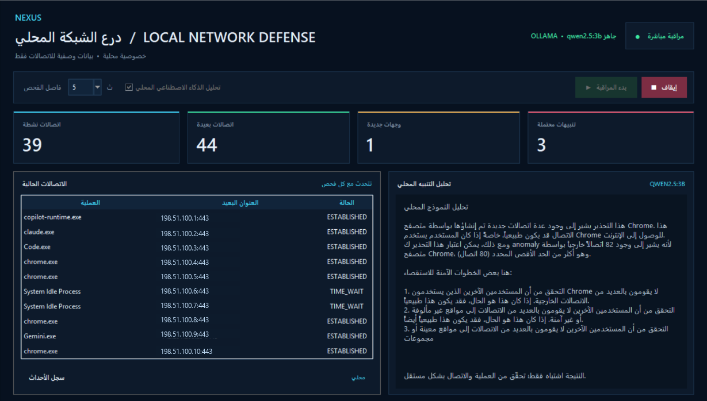

# NEXUS — وكيل أمان الشبكة المحلي

**لوحة مكتبية خفيفة متعددة الأنظمة لمراقبة البيانات الوصفية لاتصالات الشبكة، مع خيار شرح التنبيهات بواسطة نموذج Ollama محلي.**

`Windows` · `Linux` · `macOS` · `Python` · `Tkinter` · `psutil` · `Ollama (اختياري)`

[English](README.md) · [المستودع على GitHub](https://github.com/zyphros/NEXUS-Network-Security-Agent)

> المشروع نموذج أولي تعليمي للمراقبة. يعرض مؤشرات مبنية على قواعد تحتاج إلى مراجعة بشرية؛ وليس نظامًا متكاملًا لكشف الاختراق ولا يثبت أن هجومًا واقع.

## معاينة لوحة التحكم

[](docs/images/nexus-dashboard.png)

*لقطة من جلسة محلية؛ استُبدلت عناوين الاتصالات بعناوين توثيقية تجريبية.*

## ملخص المشروع

- **الهدف:** تسهيل مراجعة نشاط اتصالات الشبكة المحلية والتنبيهات البسيطة من خلال لوحة مكتبية.
- **المراقبة:** يقرأ بيانات الاتصالات الوصفية باستخدام `psutil`، ولا يلتقط محتوى الحزم.
- **الذكاء الاصطناعي:** يشرح Ollama المحلي التنبيهات أو يجيب عن سؤال في اللوحة عند الطلب.
- **مركز الأوامر:** أسئلة عن حالة اللوحة وأوامر محددة داخل التطبيق فقط؛ لا ينفذ أوامر shell أو أوامر نظام.
- **العزل:** يعرض اقتراحات حذرة للعزل والمراجعة البشرية، ولا ينهي العمليات أو يحظر الاتصالات أو يغير الجدار الناري.
- **التحكم:** تبدأ المراقبة عند ضغط المستخدم على زر البدء؛ ولا يحظر البرنامج الاتصالات أو يغير إعدادات الجدار الناري.
- **الأنظمة:** مراقبة الاتصالات تعمل على Windows وLinux وmacOS؛ وتتطلب الواجهة الرسومية توفر Tkinter.
- **النطاق:** مشروع تعليمي متعدد الأنظمة وعينة أعمال، وليس منتجًا أمنيًا جاهزًا للإنتاج.

## محتويات الدليل

- [المزايا](#المزايا)
- [المتطلبات](#المتطلبات)
- [النماذج المحلية](#النماذج-المحلية)
- [التشغيل السريع](#التشغيل-السريع)
- [الإعدادات](#الإعدادات)
- [تنظيم الملفات](#تنظيم-الملفات)
- [الخصوصية والقيود](#الخصوصية-والقيود)
- [الاختبار](#الاختبار)
- [English documentation](README.md)

## المزايا

- واجهة مكتبية عربية بتصميم سيبراني، وأزرار بدء وإيقاف، وعدّادات، وجدول اتصالات وسجل أحداث.
- يراقب البيانات الوصفية للاتصالات عبر `psutil` دون التقاط محتوى الحزم أو بيانات التصفح أو كلمات المرور.
- يطلق تنبيهات مفهومة عند تجاوز حدود اتصال محددة، ويستخدم مهلة لتقليل تكرار التنبيه.
- يمكنه تحليل التنبيه عبر Ollama محليًا؛ لا يحتاج إلى API سحابي أو مفتاح خدمة.
- يستمر جمع الاتصالات أثناء إعداد شرح أو إجابة الذكاء الاصطناعي في الخلفية.
- تستمر المراقبة حتى عند توقف Ollama أو عدم توفره.
- يوفر مركز أوامر داخل اللوحة للحالة والتنبيهات والاتصالات والتوصيات والتقارير وبدء/إيقاف المراقبة.
- يقدم توصيات عزل استشارية فقط؛ يظل قرار الاستجابة والتنفيذ بيد مسؤول مخوّل.
- يتضمن تبويبًا لبحث الويب عند الطلب: يُرسل الاستعلام إلى موجز Bing RSS، ويمكن تحليل مقتطفات النتائج عبر Ollama المحلي دون إرسال بيانات لوحة المراقبة.
- يدعم اختياريًا استقبال Syslog عبر UDP وتنبيهات Wazuh من ملف `alerts.json` للقراءة فقط.
- يحفظ السجلات والتقارير في مجلد بيانات محلي للمستخدم، خارج المستودع.
- يحد من الحمل بفواصل فحص قابلة للتعديل، وبنموذج افتراضي صغير ومكمّم بحجم 3B. يتوفر Qwen3 4B اختياريًا للتنزيل اليدوي.

## المتطلبات

- Windows 10/11 أو Linux أو macOS.
- Python 3.10 أو أحدث، متضمنًا Tcl/Tk.
- Ollama للتحليل المحلي الاختياري.
- Ollama اختياري للتحليل الذكي؛ يعمل الرصد دون تثبيته.

## النماذج المحلية

يظل `qwen2.5:3b` هو النموذج الافتراضي لتجنب حمل غير مرغوب على اللابتوب. تعرض اللوحة `qwen3:4b` و`qwen3:8b` كخيارين يدويين، وتتحقق من حجم manifest الرسمي عبر HTTPS قبل التنزيل، وترفض أي نموذج يتجاوز 5.5 GB. بلغ حجم طبقات وسم Ollama الرسمي `qwen3:8b` نحو 5.23 GB عند التحقق؛ وهو خيار أعلى قدرة لكنه يستهلك ذاكرة ومعالجًا أكثر وقد يبطئ الجهاز. يظهر تأكيد قبل تنزيله. بلغ `qwen3:4b` نحو 2.50 GB. ترخيص أوزان Qwen3 المنشور Apache 2.0؛ راجع [بطاقة النموذج الرسمية](https://huggingface.co/Qwen/Qwen3-8B) وأعد التحقق من الترخيص قبل التوزيع التجاري. اختيار «استخدام المحدد» يحفظ النموذج في `.env` لاستعماله بعد إعادة التشغيل.

لا تُضمّن الأوزان في GitHub أو مجلد المشروع؛ يخزنها Ollama في مخزنه المحلي خارج المستودع. لذلك لا تدخل الأوزان ضمن حجم ملفات المشروع المنشورة، لكن تثبيت أكثر من نموذج يزيد إجمالي مساحة مخزن Ollama. التنزيل والتفعيل اختياريان ولا يحدثان تلقائيًا. قد يستهلك الاستدلال الذاكرة والمعالج ويبطئ الأجهزة محدودة الموارد؛ يمكن إبقاء الذكاء الاصطناعي معطلًا ومواصلة الرصد بالقواعد.

## التشغيل السريع

1. ثبّت Python 3.10 أو أحدث مع Tk/Tcl. في Linux ثبّت حزمة Tk الخاصة بتوزيعتك (غالبًا `python3-tk`) إذا لم تكن موجودة. ثبّت Ollama وشغّله فقط إذا رغبت باستخدام التحليل الذكي.
2. للنموذج الافتراضي، نزّله مرة واحدة:

   ```powershell
   ollama pull qwen2.5:3b
   ```

   أو ثبّت Ollama وشغّله ثم نزّل `qwen3:4b` أو `qwen3:8b` اختياريًا من شريط **النموذج المحلي** داخل اللوحة. يُنصح بـ 8B فقط إن كانت موارد الجهاز كافية؛ يمكنك اختيار النموذج وتفعيله من الشريط نفسه. يلزم اتصال بالإنترنت لتنزيل الأوزان.

3. في Windows شغّل `setup_windows.bat`. في Linux أو macOS شغّل `bash setup_unix.sh`. ينشئ كلاهما بيئة Python مستقلة في مجلد المستخدم ويثبت مكتبة `psutil`.
4. في Windows شغّل `run_dashboard.bat`. في Linux أو macOS شغّل `bash run_dashboard.sh`.
5. اضغط زر **بدء المراقبة**. لا تبدأ المراقبة تلقائيًا. أوقفها بزر **إيقاف** أو أغلق النافذة.

لتشغيل المراقبة من الطرفية بدل الواجهة، استخدم `run_agent.bat` في Windows أو `bash run_agent.sh` في Linux/macOS. مثال لفحص واحد دون الذكاء الاصطناعي:

```powershell
run_agent.bat --once --no-ai
```

يمكن تمرير الخيارات نفسها إلى `bash run_agent.sh` في Linux أو macOS.

## التوافق متعدد الأنظمة

تم إعداد جامع الاتصالات وقراءة ملفات الأحداث للقراءة فقط للعمل على Windows وLinux وmacOS. تتطلب الواجهة الرسومية وجود Tkinter/Tcl-Tk في Python؛ وقد توفرها توزيعات Linux ضمن حزمة منفصلة. تعتمد تفاصيل العمليات والاتصالات الظاهرة على صلاحيات النظام وواجهاته. لا يوفر المشروع حاليًا تكاملات خاصة بكل نظام للتحكم في الجدار الناري أو منتجات حماية الأجهزة.

يعرض NEXUS توصيات استقصاء وعزل محتملة بعد التنبيه، لكنه لا ينفذ العزل أو يحظر الاتصالات. يتيح مركز الأوامر قائمة ثابتة من أوامر التطبيق فقط: المساعدة والحالة والتنبيهات والاتصالات والتوصيات وبدء/إيقاف المراقبة وفتح التقارير. الأسئلة الحرة تُرسل إلى نقطة Ollama المضبوطة عند توفرها؛ ولا ينفذ المركز أوامر نظام.

تشغّل GitHub Actions فحوص الصياغة واختبارات الوحدة على Windows وUbuntu Linux وmacOS. يثبت ذلك توافق الشيفرة المشتركة والاختبارات في هذه البيئات، ولا يعني دعم كل التوزيعات أو بيئات سطح المكتب أو منتجات الأمن أو منصات مراكز البيانات.

## الإعدادات

انسخ `.env.example` إلى `.env` وعدّل ما تحتاجه. ملف `.env` مستثنى من Git عبر `.gitignore`.

| الإعداد | الافتراضي | الوظيفة |
| --- | --- | --- |
| `POLL_SECONDS` | `5` | الثواني بين فحوص الاتصالات |
| `AI_ENABLED` | `true` | تفعيل تحليل Ollama المحلي الاختياري |
| `OLLAMA_URL` | `http://127.0.0.1:11434` | عنوان خدمة Ollama المحلية |
| `AI_MODEL` | `qwen2.5:3b` | اسم النموذج المثبت في Ollama |
| `AI_COOLDOWN_SECONDS` | `300` | الحد الأدنى بين طلبات التحليل |
| `AI_TIMEOUT_SECONDS` | `120` | أقصى انتظار لرد الذكاء الاصطناعي |
| `SYSLOG_UDP_ENABLED` | `false` | تفعيل مستمع Syslog UDP الاختياري |
| `SYSLOG_UDP_HOST` | `127.0.0.1` | عنوان الواجهة التي تستقبل UDP |
| `SYSLOG_UDP_PORT` | `5514` | منفذ استقبال UDP |
| `SYSLOG_UDP_MAX_SEVERITY` | `4` | أعلى شدة رقمية يعرضها Syslog (الصفر أشدها) |
| `WAZUH_ALERTS_FILE` | فارغ | مسار اختياري لملف Wazuh `alerts.json` |
| `WAZUH_MINIMUM_LEVEL` | `7` | أدنى مستوى لقاعدة Wazuh يعرضه البرنامج |
| `SURICATA_EVE_FILE` | فارغ | ملف Suricata EVE اختياري بصيغة JSON Lines؛ تُقرأ أحداث `alert` فقط |
| `ZEEK_NOTICE_FILE` | فارغ | ملف Zeek `notice.log` اختياري بعد ضبطه لإخراج JSON |
| `SNORT_ALERTS_FILE` | فارغ | ملف Snort `alert_json` اختياري بصيغة JSON Lines |
| `MAX_CONNECTIONS_ALERT` | `150` | حد تنبيه الاتصالات النشطة |
| `MAX_NEW_DESTINATIONS_ALERT` | `25` | حد الوجهات البعيدة الجديدة لكل فحص |
| `MAX_PROCESS_CONNECTIONS_ALERT` | `80` | حد الاتصالات البعيدة لكل عملية |

ارفع `POLL_SECONDS` لتقليل تكرار الفحص. الحدود إرشادية وقد تحتاج إلى ضبطها بحسب الجهاز.

## تكاملات الأحداث الأمنية (اختيارية)

مصادر القراءة الاختيارية:

- **Syslog UDP:** معطّل افتراضيًا، ويرتبط بعنوان `127.0.0.1:5514` عند تفعيله. يعرض التنبيهات بدرجة تحذير أو أعلى، أي شدة PRI من `0` إلى `4`.
- **تنبيهات Wazuh بصيغة JSON:** يتابع السجلات الجديدة التي تضاف إلى ملف `alerts.json` محلي أو مركّب، ويقبل مستوى Wazuh `7` فأعلى افتراضيًا. لا يعيد معالجة السجلات القديمة عند بدء التشغيل.
- **Suricata EVE:** يتابع أسطر JSON الجديدة ويقبل `event_type: "alert"` فقط؛ ويتجاهل سجلات التدفق وDNS وHTTP والحزم وغيرها.
- **إشعارات Zeek:** يتابع أسطر الإشعارات بصيغة JSON. يجب ضبط كاتب سجلات Zeek على JSON؛ لا تُحلل سجلات TSV الافتراضية.
- **Snort:** يتابع أسطر التنبيهات بصيغة JSON التي ينتجها مسجل `alert_json`، ويتجاهل أنواع الأحداث الأخرى.

تقرأ هذه الموصلات ملفات أنشأتها أدوات منفصلة ومثبتة ومهيأة مسبقًا. لا يثبت NEXUS الأدوات أو يشغلها أو يهيئها أو يستبدلها، ولا يلتقط الحزم بنفسه. أضف المسار فقط إذا كان الملف موجودًا وقابلًا للقراءة. لا يعيد البرنامج معالجة محتوى الملف القديم عند بدء التشغيل. الحد الأقصى للسطر 64 KiB، وقائمة الانتظار 500 سجل، ويعالج حتى 25 حدثًا مهمًا في دورة المراقبة.

أضف المصادر التي تحتاجها فقط إلى ملف `.env` المحلي. يجب أن تشير المسارات إلى ملفات مولدة مسبقًا ويمكن قراءتها على هذا الجهاز:

```dotenv
WAZUH_ALERTS_FILE=C:\wazuh-share\alerts.json
WAZUH_MINIMUM_LEVEL=7
SURICATA_EVE_FILE=C:\suricata\log\eve.json
ZEEK_NOTICE_FILE=C:\zeek\logs\current\notice.log
SNORT_ALERTS_FILE=C:\snort\log\alert_json.txt
```

يجب تفعيل مخرجات EVE للتنبيهات في Suricata، وضبط سجل Zeek بصيغة JSON، وإعداد مسجل `alert_json` في Snort. إعداد المسارات والصلاحيات وتدوير السجلات وسياسات الجمع مسؤولية المشغّل.

مثال لمُرسل Syslog محلي:

```dotenv
SYSLOG_UDP_ENABLED=true
SYSLOG_UDP_HOST=127.0.0.1
SYSLOG_UDP_PORT=5514
SYSLOG_UDP_MAX_SEVERITY=4
```

لاستقبال سجلات من جهاز بعيد، اختر واجهة الشبكة صراحةً في `SYSLOG_UDP_HOST` واضبط المُرسل وجدار حماية الجهاز بنفسك. بروتوكول Syslog UDP غير مشفر ولا يتحقق من هوية المُرسل؛ استخدمه داخل شبكة إدارة موثوقة ومعزولة أو عبر مرحّل/VPN محمي، ولا تكشف منفذ الاستقبال مباشرة على الإنترنت. تحقق من مسار السجلات قبل التشغيل. يحد البرنامج قائمة الانتظار بـ500 حدث، ويعالج حتى 25 حدثًا مهمًا في دورة الفحص لتقليل استهلاك الموارد.

يمكن ضبط `AI_MODEL` لاختيار نموذج آخر متاح عبر واجهة Ollama، بما في ذلك نموذج مضبوط للأمن السيبراني ومتوافق معها. النموذج الافتراضي `qwen2.5:3b` صغير وعام، وليس نموذجًا أمنيًا متخصصًا تم التحقق منه. اختبر أي نموذج بديل ببيانات منقحة وممثلة قبل الاعتماد على تحليلاته. مخرجات الذكاء الاصطناعي استشارية ولا تنفذ إجراءات استجابة.

## تنظيم الملفات

```text
.
├── network_agent_gui.py        # لوحة تحكم Tkinter
├── network_threat_detection.py # جمع الاتصالات والتنبيهات القائمة على قواعد
├── command_center.py           # قائمة الأوامر وإرشادات العزل الاستشارية
├── security_event_ingest.py    # مصادر Syslog ومدخلات تنبيهات JSON للقراءة فقط
├── local_model_manager.py      # تنزيل نماذج Ollama المسموح بها بحجم محدود
├── web_research.py             # بحث ويب محدود واستخراج النتائج العامة
├── setup_unix.sh               # إعداد بيئة Python في Linux/macOS
├── run_dashboard.sh            # تشغيل الواجهة في Linux/macOS
├── run_agent.sh                # تشغيل الطرفية في Linux/macOS
├── docs/images/
│   └── nexus-dashboard.png     # صورة معاينة بعد إخفاء عناوين الاتصالات
├── tests/
│   ├── test_command_center.py   # اختبارات الأوامر الآمنة والأسئلة والتوصيات
│   ├── test_rule_detector.py   # اختبارات وحدة لكاشف القواعد
│   ├── test_security_event_ingest.py # اختبارات مصادر الأحداث
│   ├── test_local_model_manager.py # اختبارات تنزيل النماذج وإعدادها
│   └── test_web_research.py    # اختبارات البحث والتحليل المحلي
├── .github/workflows/
│   └── cross-platform-tests.yml # اختبار Windows وUbuntu وmacOS
├── setup_windows.bat           # إعداد أولي على Windows
├── run_dashboard.bat            # تشغيل الواجهة
├── run_agent.bat                # تشغيل أداة الطرفية
├── README.md                    # الدليل الإنجليزي
└── README.ar.md                 # هذا الدليل
```

## الخصوصية والقيود

- قد يتضمن سجل الاتصال العنوان المحلي والبعيد والمنفذ واسم العملية وحالتها.
- عند تفعيل التكامل، قد تتضمن التقارير المحلية وصف الحدث وعنوان المرسل/المصدر ومعرّف القاعدة والدرجة واسم العميل. تعامل مع التقارير كسجلات أمنية حساسة واحمِها.
- لا يلتقط البرنامج محتوى الحزم أو كلمات المرور أو سجل التصفح، ولا يحظر الاتصالات أو يغير إعدادات الجدار الناري.
- لا تُرسل بيانات التحليل أو الأسئلة الحرة إلى الإنترنت عند استخدام عنوان Ollama المحلي الافتراضي. لا تغيّر `OLLAMA_URL` إلى مضيف بعيد إذا أردت بقاء البيانات محليًا.
- لا يبدأ بحث الويب إلا بطلب المستخدم. يُرسل نص البحث إلى Bing، وتُرسل عناوين النتائج وروابطها ومقتطفاتها العامة فقط إلى Ollama لتحليلها؛ ويُرفض التحليل إذا لم يكن عنوان Ollama محليًا (loopback). لا تُرسل اتصالات اللوحة أو تنبيهاتها أو سجل أسئلتها إلى البحث أو التحليل.
- تخضع استعلامات البحث والروابط لسياسات خصوصية Microsoft والمواقع المرتبطة. افتح المصادر التي تثق بها فقط؛ قد تكون النتائج والمقتطفات والتحليلات ناقصة أو مضللة.
- يحتفظ مركز الأوامر بآخر أسئلة وأجوبة حرة في الذاكرة لمتابعة الحوار فقط؛ ولا يحفظها على القرص.
- يقتصر مركز الأوامر على قائمة ثابتة داخل التطبيق، مع أسئلة شائعة للحالة والتنبيهات تعمل دون Ollama. لا تُشغّل مدخلات المستخدم أوامر نظام؛ الأسئلة الحرة الأخرى تحتاج إلى Ollama.
- توصيات العزل استشارية؛ يلزم التحقق المستقل وموافقة مسؤول مخوّل قبل استخدام أداة استجابة خارجية. NEXUS لا ينهي العمليات ولا يحظر الاتصالات أو يعزل الأجهزة.
- تُحفظ السجلات والتقارير في `~/.network_security_agent/data`، خارج ملفات المستودع.
- يستثني `.gitignore` ملف `.env` والبيئة الافتراضية والسجلات والتقارير والنماذج وقواعد البيانات. راجع `git status` قبل النشر.
- قد لا تُرصد الاتصالات القصيرة بين مرات الفحص، وقد تمنع صلاحيات النظام الوصول إلى معلومات بعض العمليات المحمية.
- تقتصر التكاملات على Syslog UDP وصيغ تنبيهات محددة من Wazuh وSuricata وZeek وSnort؛ ولا تمثل موصلًا عامًا لكل أنظمة SIEM/EDR أو خدمة مراكز بيانات عالية التوافر.
- يتطلب بحث الويب اتصالًا بالإنترنت واستجابة RSS متوافقة من Bing. يستخرج حتى خمس نتائج ولا يزحف صفحات الويب كاملة أو يضمن موثوقية المصادر؛ راجع المصادر نفسها.
- يجب أن يكون ملف Wazuh قابلًا للقراءة من الجهاز الذي يشغل NEXUS. إعداد مشاركة الملفات والصلاحيات وتسليم الأحداث وقواعد الجدار الناري مسؤولية المشغّل.
- Syslog UDP لا يتحقق من هوية المُرسل ولا يشفر البيانات؛ استخدمه على شبكة موثوقة أو من خلال مرحّل محمي.
- لا يدير المشروع مفاتيح التشفير أو يضبط الأنظمة التشفيرية أو يعزل الأجهزة أو يفرض سياسات أمنية.
- التنبيهات قد تكون خاطئة، ويجب التحقق منها. مخرجات النموذج المحلي استشارية فقط وقد تكون غير دقيقة، ولا يتخذ البرنامج إجراءات تلقائية.
- قد يستهلك Ollama المعالج والذاكرة أثناء إعداد الشرح.

## الاختبار

```sh
python -m py_compile network_threat_detection.py network_agent_gui.py security_event_ingest.py command_center.py web_research.py
python -m unittest discover -s tests -v
python network_threat_detection.py --once --no-ai
```

## الترخيص

حقوق النشر © 2026 zyphros. جميع الحقوق محفوظة.

لا يُمنح بموجب هذا المستودع إذن باستخدام المشروع أو نسخه أو تعديله أو إعادة توزيعه. يُرجى التواصل مع مالك حقوق النشر لطلب الإذن.
